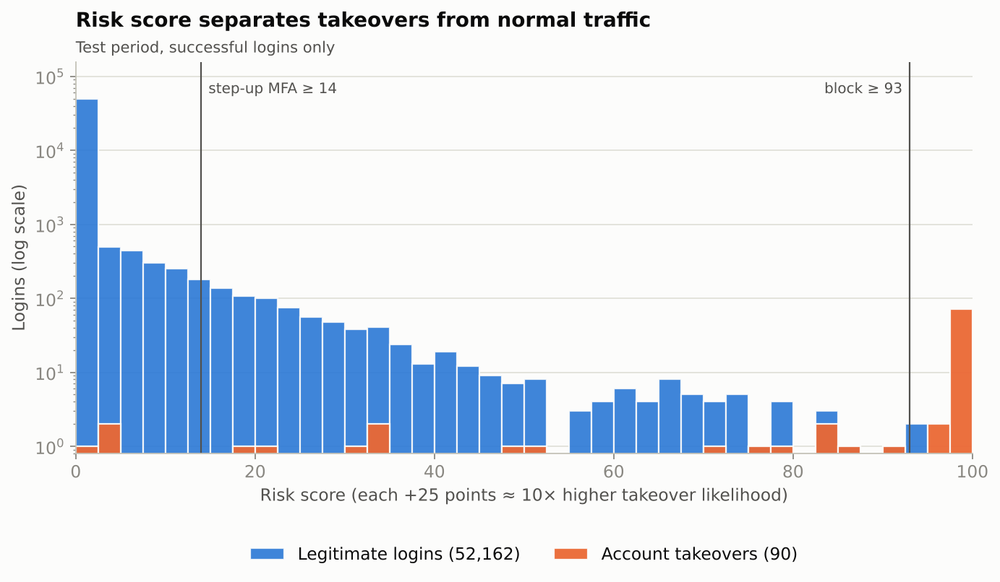
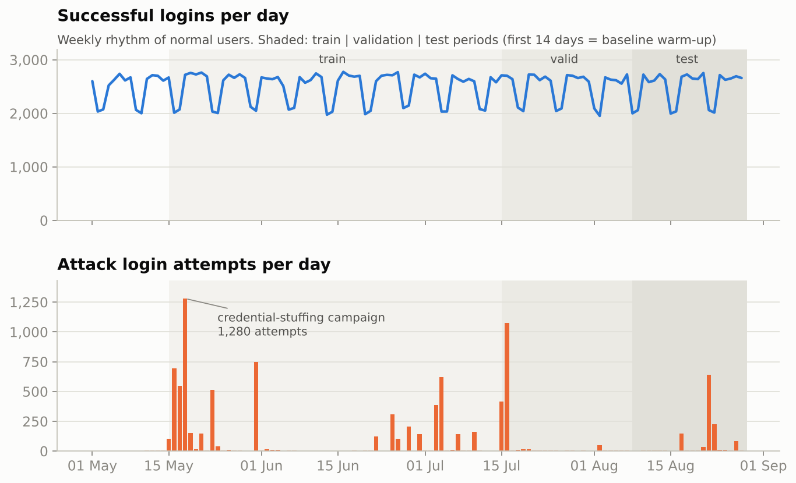
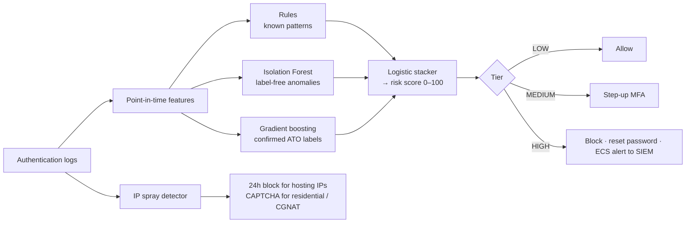
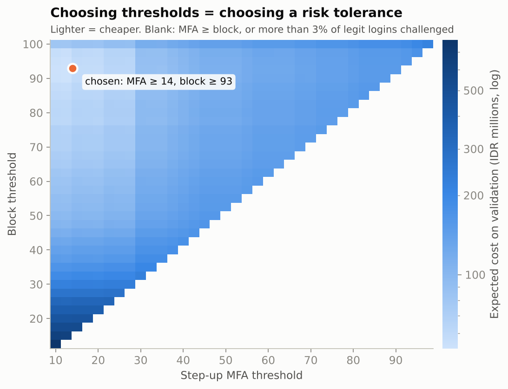
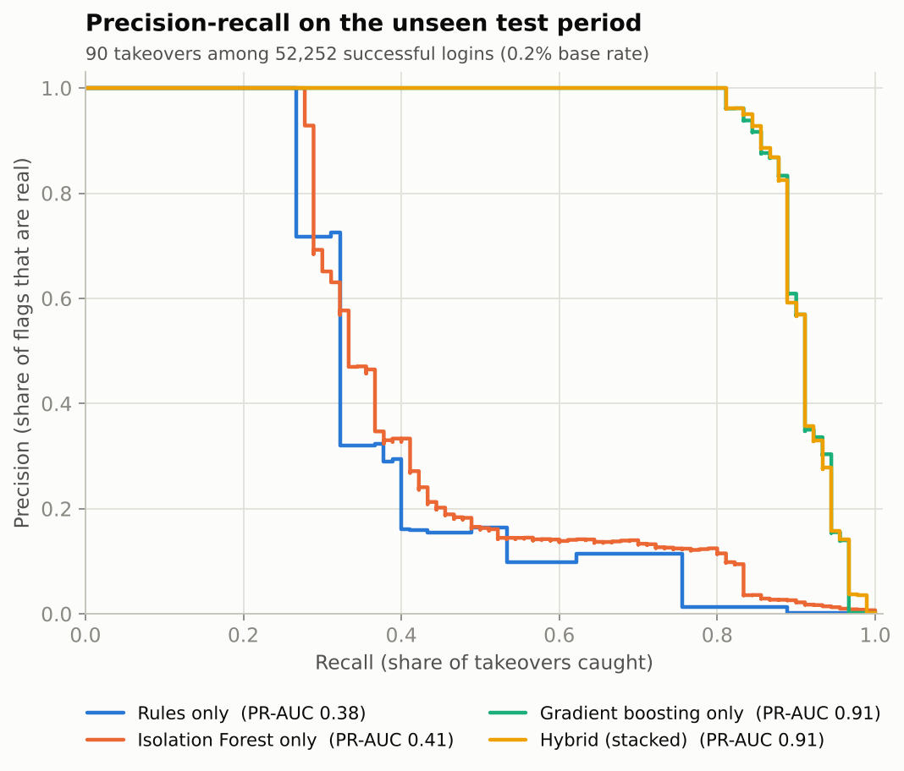
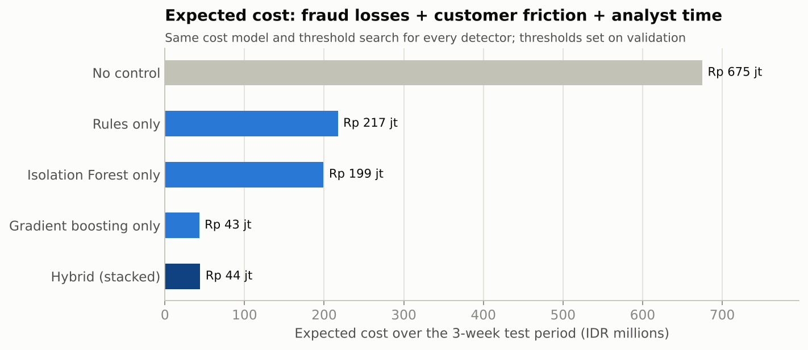
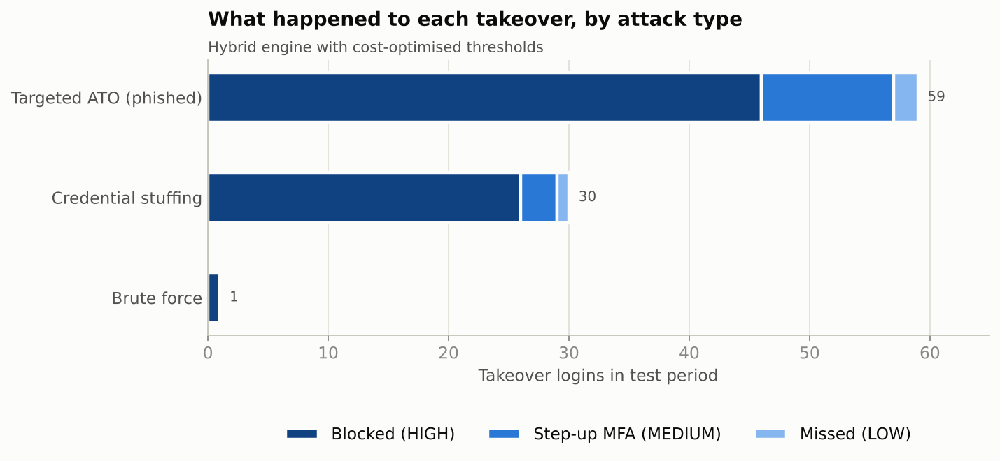
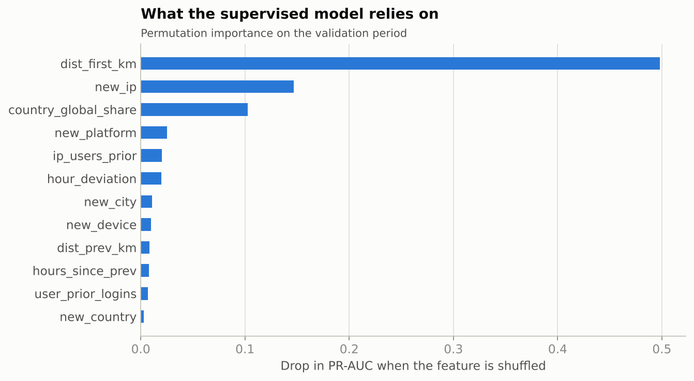

# Account Takeover Detection & Login Risk Scoring

**A hybrid fraud-detection engine that scores every login 0–100 and decides in real time whether to
*allow*, *step up to MFA*, or *block and alert the SOC*.** It combines detection rules, unsupervised
anomaly detection and a supervised model. Thresholds come from an explicit cost model, so they double
as the organisation's risk tolerance, and alerts are emitted as SIEM-ready ECS JSON with
human-readable reason codes.



> ⚠️ **Synthetic data.** All telemetry is generated by `src/ato/generate.py` (≈333k login events,
> 2,500 users, 4 months), modelled on the public RBA dataset schema, with injected attack campaigns.
> IP addresses are random and do not refer to real hosts. The numbers below describe this
> simulation. They are not production results.

---

## TL;DR: results on the unseen test period (3 weeks, 52k successful logins, 90 takeovers)

| | Rules only | Isolation Forest only | Gradient boosting only | **Hybrid (final)** |
|---|---|---|---|---|
| PR-AUC (95% CI) | 0.38 (0.29–0.48) | 0.41 (0.32–0.52) | 0.91 (0.86–0.95) | **0.91 (0.86–0.95)** |
| Takeovers intercepted (blocked + MFA) | 75.6% | 83.3% | 96.7% | **96.7%** |
| Takeovers blocked outright | 32.2% | 0.0% | 81.1% | **81.1%** |
| Legit logins asked for MFA | 0.99% | 1.86% | 1.50% | **1.57%** |
| Legit logins blocked | 0.021% | 0% | 0% | **0.004%** |
| SOC alerts per day (precision) | 1.9 (73%) | 0 (n/a) | 3.5 (100%) | **3.6 (97%)** |
| Expected cost, IDR | 217 jt | 199 jt | 43 jt | **44 jt** |

*No control at all would cost an expected Rp 675 jt over the same period. Every detector gets the same
threshold search on the validation weeks, and is then frozen for the test weeks.*

**Key findings**

1. **Rules alone are noisy.** "Impossible travel" fires about 8 times a day at roughly 10% precision,
   because VPN users and travellers trip it. "Odd login hour" fires about 265 times a day at 0.6%.
   The context-aware model cuts expected cost by **80%** versus the rules.
2. **On known attack types, the hybrid matches the supervised model; it does not beat it.** Its value
   shows when labels are missing. When credential-stuffing labels were hidden from training, recall
   on that attack (at a 2% legit-challenge budget) was: gradient boosting 86.7%, **hybrid 90.0%**,
   Isolation Forest 93.3%, rules 80.0% (n = 30, so treat this as indicative).
3. **Legit-but-unusual users get challenged, almost never blocked.** 29–62% of travel and VPN logins
   are asked for MFA, and at most 1.2% are blocked. Ordinary logins are challenged only 0.8% of the
   time, while 78–100% of takeovers are blocked (see notebook §5).
4. **Hard-blocking IPs is dangerous on mobile carriers.** Attackers hide behind residential proxies and
   CGNAT addresses shared with real customers. The IP control therefore blocks hosting IPs for 24h and
   only adds CAPTCHA and rate limits to residential/mobile IPs. Result: 0 legit logins hard-blocked.

---

## 1. Problem

Account takeover (ATO) happens when an attacker logs in with a victim's real credentials. Common sources
are phishing, reused passwords from breaches (credential stuffing), and brute force. Because the password
is correct, the login looks valid. The only signal is **behaviour**: a new device, an unusual network,
an impossible journey, a burst of failures.

The engine has to:
- catch takeovers at the moment of login,
- avoid annoying or locking out real customers (travellers, VPN users, people with new phones),
- give analysts and auditors an explanation for every decision, and
- produce evidence that the control works.

## 2. Data

| Field group | Columns |
|---|---|
| Event | `login_ts`, `user_id`, `login_successful` |
| Network | `ip`, `asn`, `asn_name`, `asn_type` (fixed / mobile / hosting), `country`, `region`, `city` |
| Client | `user_agent`, `browser`, `os`, `device_type`, `device_id` |
| Ground truth (evaluation only) | `is_attack_ip`, `is_account_takeover`, `scenario` |

**Legitimate noise:** shared mobile CGNAT IPs, shared office IPs, DHCP rotation, trips (domestic and
abroad, with roaming vs hotel Wi-Fi), phone upgrades, commercial VPN users, password typos, and
forgotten passwords.

**Attacks:**
- **Credential stuffing:** 8 campaigns through hosting and residential proxies, some returning later
  to monetise the account.
- **Targeted ATO:** phished credentials, used either from abroad, from a VPN, or *stealthily* from an
  Indonesian mobile carrier during normal hours.
- **Brute force.**



## 3. Approach



### Features (`src/ato/features.py`)
Every feature uses **only earlier events**, which is what a real-time engine knows when the password has
just been verified. A unit test proves that adding future data never changes a past feature.

| Family | Examples |
|---|---|
| User baseline | first time seen: country, city, ASN, IP, device, browser/OS; account history length |
| Velocity | km and km/h since the previous successful login; distance from the first-seen location |
| Temporal | deviation from the user's usual login hour (circular mean); time since last login |
| Pressure | failed logins on the account (1h/24h); attempts, failures and distinct users per IP; failures per ASN |
| Reputation | hosting/VPN ASN, automation user-agent, how rare the country is on the platform |

### Models (`src/ato/model.py`)
- **Rules:** 9 transparent SIEM-style rules with points (`src/ato/rules.py`).
- **Isolation Forest:** unsupervised, so it needs no labels. Its output is converted to a percentile.
- **HistGradientBoosting:** supervised on confirmed takeovers.
- **Stacker:** a logistic regression trained on *out-of-fold, time-ordered* predictions to avoid leakage.

  `risk_score = 25 × (log10 p + 4)`, which means **every +25 points is 10× more likely to be a takeover**.
  That scale is easy to explain to non-technical stakeholders.

### Thresholds = risk tolerance (`src/ato/policy.py`)

| Outcome | Assumed cost (IDR) |
|---|---|
| Missed takeover | 7,500,000 |
| MFA prompt to a legit user (friction) | 2,500 |
| Legit user blocked (support, churn) | 500,000 |
| Analyst review of a HIGH alert | 40,000 |
| Takeovers that also bypass MFA (phished OTP) | 15% |

The two thresholds (MFA, block) are found by grid search that minimises expected cost on validation,
with a cap of 3% on legit users challenged. Changing these numbers *is* changing the risk appetite, so
they belong to Fraud and GRC, not only to data science.



## 4. Results






**Credential-stuffing IP detector (test period):** flagged 45 of 91 attacker IPs. It hit 332 of 1,199
attack attempts with a block or CAPTCHA, and blocked 0 legit logins outright (34 got a CAPTCHA). Many
stuffing attempts are "low and slow", one or two per IP, which is why per-login scoring is still needed.

## 5. Explainability & SIEM output

Every MEDIUM/HIGH decision is written as an [Elastic Common Schema](https://www.elastic.co/guide/en/ecs/current/index.html)
document (`reports/alerts_test.jsonl`). It can be shipped to Elasticsearch/Kibana, Splunk HEC or QRadar:

```json
{"@timestamp": "2026-08-10T00:09:38+07:00",
 "event": {"kind": "alert", "category": ["authentication"], "action": "block_session_and_reset_password"},
 "user": {"name": "u01908"},
 "source": {"ip": "132.214.79.73", "geo": {"country_iso_code": "RU", "city_name": "Moscow"},
            "as": {"number": 12389, "organization": {"name": "Rostelecom"}}},
 "risk": {"calculated_score": 100.0, "calculated_level": "high"},
 "ato": {"reasons": ["R01_IMPOSSIBLE_TRAVEL", "R02_NEW_COUNTRY_NEW_DEVICE",
                     "R07_NEW_DEVICE_NEW_NETWORK", "R08_RARE_COUNTRY"],
         "signals": {"ml_probability": 0.9997, "anomaly_percentile": 0.9995, "rule_points": 100}}}
```

## 6. Governance & compliance
- [`docs/control_mapping.md`](docs/control_mapping.md): mapping to NIST CSF 2.0, ISO/IEC 27001:2022
  Annex A and COBIT 2019, KPI/KRI table with evidence artefacts, privacy notes (GDPR / UU PDP).
- [`docs/alert_playbook.md`](docs/alert_playbook.md): triage per reason code, containment, closure
  codes that feed labels back to the model, weekly monitoring (PSI drift, rule hygiene).
- [`notebooks/01_walkthrough.ipynb`](notebooks/01_walkthrough.ipynb): EDA, rule noise analysis, model
  comparison, and a reconstructed alert timeline (mini post-incident review).

## 7. Limitations (read before quoting numbers)
- **Synthetic attackers are simpler than real ones.** Real adversaries adapt to controls. Expect lower
  performance on real data.
- **The test set is small** (90 takeovers). The bootstrap intervals above are wide on purpose.
- **Labels are perfect here.** In reality they arrive late and incomplete (customer reports,
  chargebacks). Training on delayed labels is the next step.
- **Behaviour drifts.** Friction and alert volume move over time, so thresholds need regular
  recalibration (see playbook).
- **Not yet built:** device-fingerprint reputation, graph features (accounts sharing devices or IPs),
  a live Kibana dashboard.

## 8. Run it

```bash
pip install -r requirements.txt
python scripts/run_pipeline.py --regen   # generate data, train, evaluate, write reports (~2 min)
python scripts/build_notebook.py         # rebuild the executed walkthrough notebook
python scripts/build_page.py --repo https://github.com/<you>/ato-risk-scoring   # portfolio page
pytest -q                                # tests: leakage, window maths, policy, alert schema
```
`docs/index.html` is a self-contained case-study page (figures embedded). To publish it, enable
GitHub Pages from the `/docs` folder, or copy the file to your own site.
Tested with Python 3.13, pandas 3.0, scikit-learn 1.9 and matplotlib 3.11.

**Using the real RBA dataset.** Map its columns (`Login Timestamp → login_ts`, `User ID → user_id`,
`IP Address → ip`, `ASN → asn`, `Login Successful → login_successful`, `Is Account Takeover →
is_account_takeover`, …). Then add three things the RBA data lacks: a city → lat/lon lookup
(e.g. GeoNames) in place of `reference.CITIES`, an ASN-type list (hosting vs consumer), and a
`device_id` (e.g. a hash of user + user-agent).

```
├── src/ato/
│   ├── generate.py    synthetic telemetry + attack campaigns
│   ├── reference.py   cities, ASNs, user-agents (enrichment stand-ins)
│   ├── features.py    point-in-time behavioural features
│   ├── rules.py       detection rules + reason codes
│   ├── model.py       Isolation Forest + gradient boosting + stacker → score
│   ├── policy.py      cost model, threshold search, evaluation, IP detector
│   ├── alerts.py      ECS JSON alert writer
│   └── report.py      dashboard figures
├── scripts/           run_pipeline.py, build_notebook.py, build_page.py
├── notebooks/         01_walkthrough.ipynb
├── docs/              control_mapping.md, alert_playbook.md, index.html (portfolio page)
├── reports/           metrics.json, alerts, blocklist, figures
└── tests/
```

---
**Author:** Addin · [LinkedIn](https://www.linkedin.com/in/muhamadaddinalhaadi/) · [Portfolio](https://addin-porto.netlify.app)
